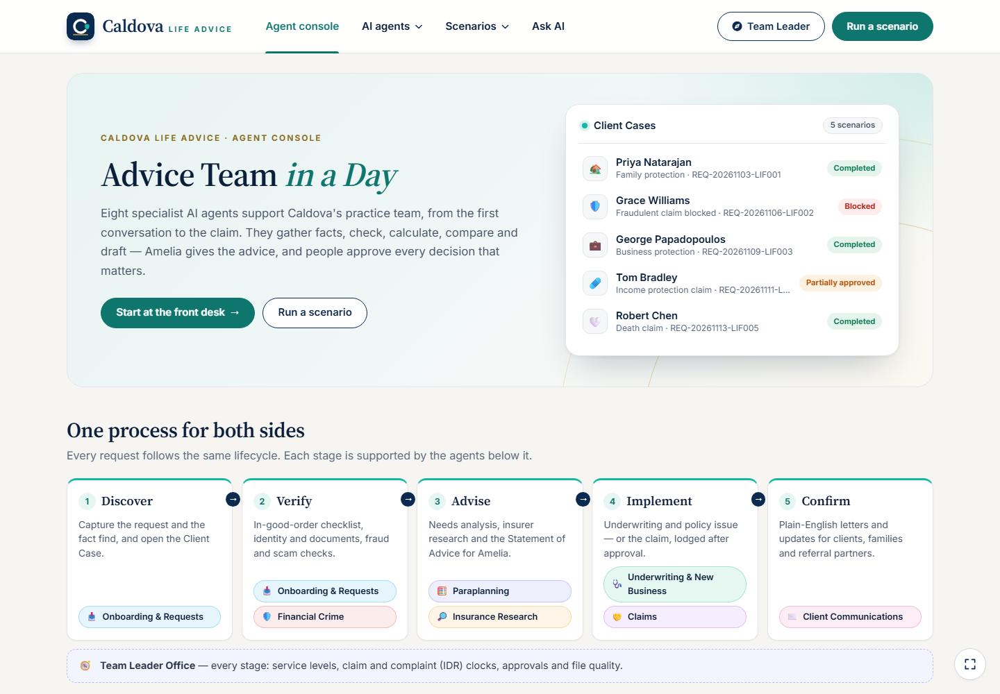
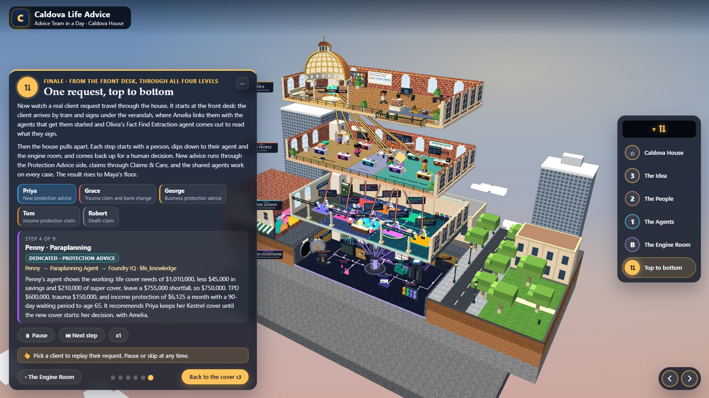

# Advice Team in a Day

A demo for **Caldova Life Advice**, a fictional life insurance advice practice in Melbourne that helps families and business owners protect their income, their family and their business. It shows an advice practice run with a coordinated team of specialised AI agents.

At Caldova, each department has its own AI agent that supports a named staff member through the full request lifecycle: **Discover → Verify → Advise → Implement → Confirm**. The departments cover:

- onboarding and requests
- paraplanning and needs analysis
- insurance research
- financial crime
- underwriting and new business
- claims
- client communications
- team leadership

The agents gather facts, explain rules, calculate needs and benefits, compare insurers and draft. **Amelia**, Caldova's adviser, gives the advice and signs every Statement of Advice, and people approve every decision that matters.

See [AGENTS.md](AGENTS.md) for the overview, and the [docs/](docs/) folder for the industry background, characters, process, scenarios and the Caldova House [storybook](docs/storybook.md) behind the frontend.

---

## The Advice Practice Agent Team

Each agent owns one part of the request lifecycle, and all of them share a common **Client Case** record. Agents support human judgement; they don't replace it, and they never give personal advice.

Human approval is always required for:

- every Statement of Advice and Record of Advice, which the adviser signs
- replacing or cancelling any existing cover
- accepting a loading, an exclusion or a decline at underwriting
- lodging any claim, and every death or terminal illness claim
- blocking a request on financial-crime grounds, and referring suspected fraud to an insurer
- any change to policy ownership, beneficiaries or bank details
- advice with total cover of $2,000,000 or more on one case, which gets a second review
- complaint responses
- any communication to a fraud victim, a seriously ill client or a bereaved family

| # | Agent (staff name) | Staff role | What it does |
|---|---|---|---|
| 1 | **Onboarding Agent** (Olivia) | Onboarding & Requests Officer | Reads enquiries, referrals, fact finds and claim notifications, and extracts every field. It runs the in-good-order checklist, flags existing cover at risk and vulnerable clients, then opens the Client Case and routes it. |
| 2 | **Paraplanning Agent** (Penny) | Paraplanner | Works out how much life, TPD, trauma, income protection and business cover is needed, showing its working, and how to hold it inside or outside super. It drafts the Statement of Advice for the adviser, with commission in dollars, and cites each rule. |
| 3 | **Insurance Research Agent** (Ivy) | Insurance Research Analyst | Compares the insurers on Caldova's approved product list (APL) on definitions, features, exclusions and stepped and level premiums, and builds an Excel workbook with a premium chart. |
| 4 | **Financial Crime Agent** (Felix) | Financial Crime Investigator | Checks that IDs, medical reports, death certificates, payslips, BAS and bank statements are authentic, and builds a risk timeline of contact and bank-detail changes. It screens for politically exposed person (PEP) and sanctions matches, gives an explainable risk rating, and recommends holds and call-backs. |
| 5 | **Underwriting Agent** (Uma) | Underwriting Coordinator | Explains the duty to take reasonable care, prepares the application, tracks the medical and financial evidence the insurer needs, explains loadings and exclusions, and generates the application summary PDF. |
| 6 | **Claims Agent** (Ben) | Benefit Claims Advocate | Checks the claimant, the policy and the evidence, builds the claim pack and calculates the benefit. It raises a Microsoft Teams approval card, lodges the claim only after a person approves, and tracks the insurer's Code of Practice timeframes. |
| 7 | **Client Communications Agent** (Cara) | Client Communications Specialist | Drafts plain-English letters, policy summaries, claim updates, SMS and referral-partner updates in the right tone, sharing only what the client agreed to share. It checks drafts for compliance, and Cara also has a voice agent that takes calls. |
| 8 | **Team Leader Agent** (Theo) | Practice Team Leader | Watches the whole practice: the advice pipeline, underwriting and claim clocks, complaint (IDR) clocks, approvals, second reviews, file quality and vulnerable clients. It also runs a group chat that coordinates the other seven agents on one case. |

### How a Request Flows Through the Team

1. A client, a family member or a referral partner makes a request.
2. **Onboarding & Requests** captures it, runs the fact find and the in-good-order checklist, and opens the Client Case.
3. **Paraplanning** works out how much cover is needed and how to hold it, and drafts the Statement of Advice for the adviser, citing each rule.
4. **Insurance Research** compares the insurers on the APL on definitions, features and premiums.
5. **Financial Crime** verifies identity and documents, and screens for fraud, scams and identity takeover.
6. **Underwriting & New Business** takes the application through underwriting with the insurer and gets the policy issued.
7. **Claims** supports clients and families through a claim: it checks the policy, builds the claim pack, calculates the benefit and lodges the claim after approval.
8. **Client Communications** keeps clients, families and referral partners informed in plain English.
9. **Team Leader Office** monitors workload, service levels, complaint (IDR) clocks, approvals and file quality.

For each agent's capabilities, inputs, tools, outputs and human-approval rules, see [docs/foundry_agents.md](docs/foundry_agents.md).

---

## Scenarios

All five scenarios use fictional people, insurers, super funds and businesses. The dates are in November 2026 (FY2026-27).

| # | Scenario | Client | Case | Outcome |
|---|---|---|---|---|
| 1 | [New family protection advice](docs/scenario-1-family-protection.md) | Priya Natarajan | `REQ-20261103-LIF001` | ✅ Completed: life $750,000, TPD $600,000, trauma $150,000 and income protection of $6,125 a month from 18 Nov 2026, with her old super cover kept until the new cover started |
| 2 | [Identity takeover and a fake trauma claim, blocked](docs/scenario-2-fraudulent-claim.md) | Grace Williams | `REQ-20261106-LIF002` | 🛡️ Blocked: no claim lodged, and $200,000 protected |
| 3 | [Business protection: buy-sell and key person cover](docs/scenario-3-business-protection.md) | George Papadopoulos, with Harpreet Kaur | `REQ-20261109-LIF003` | ✅ Completed: buy-sell cover of $1.2 million on each owner and $400,000 of key person cover from 20 Nov 2026, after a second review |
| 4 | [Income protection claim after an injury](docs/scenario-4-income-protection-claim.md) | Tom Bradley | `REQ-20261111-LIF004` | 🟡 Partially approved: $5,600 a month, not the $7,000 insured, because the benefit follows his earnings |
| 5 | [Death claim after the sudden death of his wife](docs/scenario-5-death-claim.md) | Robert Chen | `REQ-20261113-LIF005` | ✅ Completed: $1,000,000 paid to Robert on 23 Nov 2026, with the super claim under way |

For a presenter walkthrough and the 10-minute golden path, see [docs/agent-demo.md](docs/agent-demo.md).

---

## Built on Microsoft Foundry

Each staff role is a **Microsoft Foundry** agent. Every agent showcases at least one Foundry capability:

| Capability | How the demo uses it | Agents |
|---|---|---|
| **Declarative agents** (`Azure.AI.Projects`) | Each role is a Foundry agent created from code on a shared `CaldovaAgent` base class, with its own instructions and structured output. | All nine (eight staff agents plus Cara's voice agent) |
| **Azure AI Search grounding** | Answers are grounded in, and cite, the `life_knowledge` index: the insurers' PDS extracts, Caldova's Financial Services Guide and APL, the rules on advice, insurance in super, underwriting, claims, tax and commission, Caldova's guides, and the case files. | All. Paraplanning cites a rule for every step |
| **Bing grounding** | Public web grounding for up-to-date reference information. | All, through the shared base class |
| **MCP tools** (served by the backend at `/mcp`, server label `caldova-ops-mcp`) | **Insurance Research:** analyse policy documents, compare insurers, build the comparison workbook. **Underwriting:** look up insurers, check underwriting requirements, generate the application summary PDF. **Claims:** validate the claimant, check the policy, calculate the benefit, check the approval rules, request and track approval, and lodge the claim. **Teams:** send the approval card. | Ivy, Uma, Ben |
| **Azure Content Understanding** | Checks the authenticity of IDs, medical reports, death certificates, payslips, BAS and bank statements, and returns a legit, suspicious or fake verdict with the reasons. | Felix |
| **Microsoft Teams adaptive-card approvals** | A claim is lodged only after a person approves the card in Teams. | Ben, with Theo approving |
| **Voice Live** | Talk to Cara by voice about a case. | Cara (voice agent) |
| **Multi-agent group chat** | Theo orchestrates the seven specialists on a single case. | Theo |

---

## Run It Locally

**Prerequisites**

- .NET 10 SDK
- Node.js 18 or later
- Azure CLI, signed in with `az login`. The agents authenticate with `DefaultAzureCredential`.
- A Microsoft Foundry project with:
  - a model deployment
  - an Azure AI Search connection to the `life_knowledge` index (see [ai-search/README.md](ai-search/README.md) to build it)
  - a Bing grounding connection

**Configuration.** Set these keys in `src/backend/appsettings.json` and `src/agent/appsettings.json`, or as environment variables:

- `AZURE_AI_PROJECT_ENDPOINT`
- `AZURE_AI_MODEL_DEPLOYMENT_NAME`
- `AZURE_TENANT_ID` (optional)
- `AZURE_AI_SEARCH_CONNECTION_ID`
- `AZURE_AI_SEARCH_INDEX_NAME`, set to `life_knowledge`
- `AZURE_BING_CONNECTION_ID`

The backend also uses `APP_MCP_URL`, the public base URL where Foundry reaches the backend's `/mcp` endpoint. When you run locally, point it at the deployed `app-caldovacl-backend` or at a dev tunnel.

If Foundry isn't configured or can't be reached, the agent pages fall back to **offline** results for the five scenario cases.

**Backend** (Blazor agent console and APIs, at <http://localhost:5212>):

```powershell
dotnet run --project src/backend/cl-backend.csproj
```

**Frontend** (the voxel Caldova House storybook, at <http://localhost:5173>):

```powershell
cd src/frontend
npm install
npm run dev
```

**Agent CLI** (run any agent from the command line):

```powershell
cd src/agent
dotnet run -- --onboarding "Referral from Hannah Lewis (Yarra Home Loans): Priya Natarajan, 34, physiotherapist, new $680,000 mortgage, old Kestrel Retail Super account with no contributions since 30 Jul 2025"
```

The other flags are `--paraplanning`, `--research`, `--fincrime`, `--underwriting`, `--claims`, `--communications` and `--team-leader`.

To deploy to Azure (resource group `rg-caldova-life`), see `bicep/` and the GitHub Actions workflows in `.github/workflows/`.

---

## Screenshots

### Backend: Agent Console

The backend home page lists the eight agents at Caldova Life Advice. Each card opens the agent's page, where **Try it out** runs the agent live against the scenario cases. Every run shows the agent's narrative, the references it cited, its prompt and tools, its input and its raw output.



### Frontend: the Caldova House Storybook

The frontend shows the same team as a voxel storybook you read from the top of Caldova House to the bottom. Caldova House is a heritage building on a Melbourne city corner, built in 1889 as a bank, with a super modern, futuristic office inside. Caldova is an advice practice for the agentic era, with two sides: Protection Advice and Claims & Care.

- **Level 3** is business owner Maya Ashworth's office under the old copper dome, with her idea, "the brain", with one half for each side.
- **Level 2** holds two small teams, one for each side, with Olivia at the front door and Theo leading both teams.
- **Level 1**, the old banking chamber at street level, has one group of Microsoft Foundry agents that supports both teams. Some agents are dedicated to a side and some are shared by both. Each agent and each of its specialised assistants is its own robot: 25 roles in all.
- **The engine room**, in the old bank vault in the basement, holds Microsoft IQ (Work IQ, Fabric IQ, Foundry IQ and Web IQ) with the Azure services around it.

People and agents move about their floors as they work. Out front, clients, families and referral partners arrive by tram and sign at the front desk under the heritage verandah, where Amelia links them with the agents that get them started. Up on the roof, Caldova throws a party for its clients under a big CALDOVA LIFE ADVICE sign. Each chapter opens up one level. The finale starts at the front desk, then opens up the house to trace a client's request from top to bottom. See [docs/storybook.md](docs/storybook.md).



---

## Contributing

Contributions are very welcome! You could add or refine an agent, sharpen a scenario, polish Caldova House, or fix a typo.

Ways to contribute:

- **Open an issue** to report a bug, suggest an enhancement, or propose a new client scenario.
- **Submit a pull request** with code, content or documentation changes. Small PRs are perfect.
- **Share ideas** for new agents, client personas or practice workflows that fit the Caldova Life Advice story.
- **Improve the docs** in the [docs/](docs/) folder: background, characters, process, scenarios and visual themes.

Keep contributions aligned with these principles:

- Keep the Caldova House metaphor and the guidance in [AGENTS.md](AGENTS.md).
- Agents support people and never give personal advice. The adviser gives the advice.
- Rules and numbers must be real, current and cited.
- People, insurers, super funds and businesses stay fictional.

Be kind, be constructive, and have fun building the advice team.
