# Storybook — Caldova House

> Part of **Advice Team in a Day** — the AI advice practice demo for **Caldova Life Advice**.

The frontend, served at **`/`**, tells the Advice Team in a Day story as a storybook. Caldova Life Advice is a life insurance advice practice built for the agentic era. It has **two sides**, Protection Advice and Claims & Care, with a **small team for each side** and **one group of AI agents** that supports both. It works from **Caldova House**, a bank built in 1889 on a Melbourne city corner, with a super modern, futuristic office inside. Viewers read the story from the top of the house to the bottom: the business owner's idea, the two teams, the agents, and the Microsoft IQ and Azure services underneath.

This document is the source of truth for the frontend: the setting, the cast, every page and how each page behaves. The page text in [`src/frontend/src/v2/storyData.ts`](../src/frontend/src/v2/storyData.ts) mirrors it, so change both together.

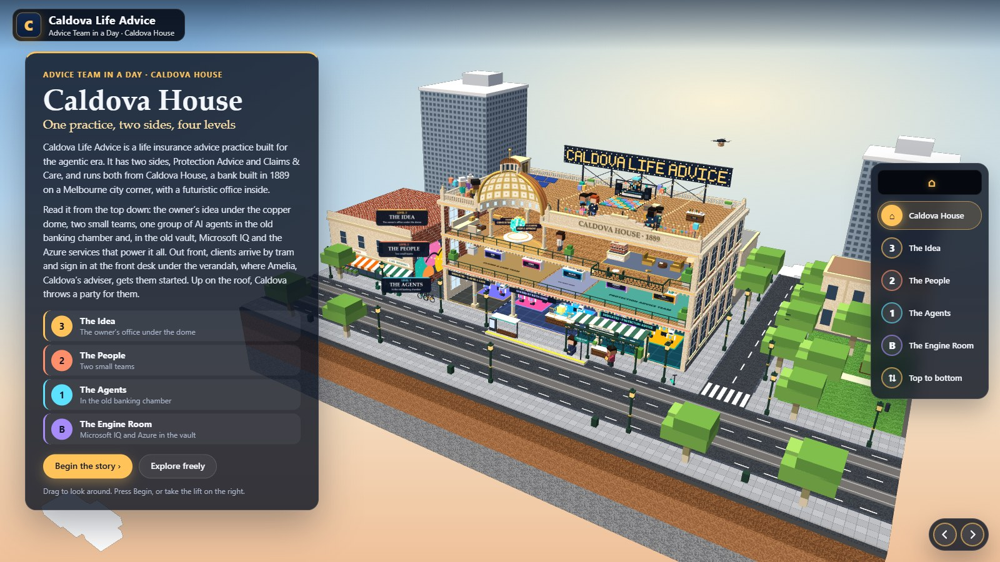

---

## The Big Idea

**One practice, two sides, four levels, read from the top down.**

| Level | Name | Who or what is there | The question it answers |
|---|---|---|---|
| **3** | **The Idea** | Maya Ashworth, the business owner for both sides, and her idea, "the brain", under the copper dome | Why are we doing this, and what are the rules? |
| **2** | **The People** | Two small teams, one for each side, with Olivia at the front door and Theo leading both | Who makes the decisions? |
| **1** | **The Agents** | One group of Microsoft Foundry agents in the old banking chamber: some dedicated to a side, some shared by both | Who does the reading, checking, calculating and drafting? |
| **B** | **The Engine Room** | Microsoft IQ and the Azure services, in the old bank vault | Where does the context come from, and what keeps it all running? |

Each level hangs off the one above it:

- The idea sets the goals and guardrails for both sides.
- People own the decisions, in two small teams. Amelia, Caldova's adviser, gives the advice.
- Each person's agent sits directly underneath them and reports back to them. The agents form one group: dedicated where the work is specialised, shared where it isn't.
- Microsoft IQ gives every agent the same context, and the Azure services power them all.

A thread runs through the whole house: **idea → person → agent → Microsoft IQ and Azure**. Whatever the viewer clicks, they can follow that thread up or down.

Both sides follow one request lifecycle, **Discover → Verify → Advise → Implement → Confirm**, shown on the process board on Level 2. The finale traces one request through it, from the front desk to the result.

### The Two Sides

| Side | What it looks after | Team | Dedicated agents |
|---|---|---|---|
| **Claims & Care** (gold `#c9a14a`, on the left) | Existing clients: annual reviews, changes to their cover, and support through every claim | Claims & Care Team: Ben, Cara and Felix | Claims Agent |
| **Protection Advice** (teal `#14b8a6`, on the right) | New advice for individuals, families and business owners: life, TPD, trauma, income and business protection | Protection Advice Team: Penny, Ivy and Uma | Paraplanning, Insurance Research and Underwriting agents |
| **Shared by both** (lilac `#8b9cf7`, in the middle) | The front door and leadership | Olivia takes every request in, and Theo leads both teams | Onboarding, Financial Crime, Client Communications and Team Leader agents |

Cara and Felix sit with the Claims & Care Team. Their work, communications and financial crime, spans both sides, so their agents are **shared**. Olivia is listed with the Protection Advice Team, but every request from both sides comes in through her, so she sits at the front door in the middle of the floor and her Onboarding Agent is shared too. New advice has the most specialised steps (needs analysis, research and underwriting), so the Protection Advice side has the most dedicated agents. If a request ever needs the other side's dedicated agent, that side is **called in**.

---

## The Setting: Caldova House

Caldova Life Advice works from Caldova House, a heritage bank on a Melbourne city corner, built in 1889. Outside, it is the old bank. Inside, it is a super modern, futuristic office. The whole scene is a floating voxel city block, with layers of earth under the street.

- **The house:** three storeys and a basement of 1889 red brick, with cream render cornices and dentils, quoins at the corners, pilasters along the side street, arched windows with keystones and sills, and a bluestone base at street level.
  - **The dollhouse cut:** the front of the house is cut away, so every floor reads clearly from the street. Along the cut, each floor's edge is a band of cream render with a cornice, a slim rail and an LED strip in that level's accent colour. There is no glass facade.
  - **The futuristic inside:** white desks with neon edges, holographic boards, a glowing grid floor in the old banking chamber, and a lift core in the back-left corner with brass cage doors and a floor number lit above them on every level.
  - **The copper dome** rises over Maya's office on Level 3. The cut opens it too: copper standing seams outside, cream and gold coffers inside, a gold rim along the cut, and a lantern and gold finial on top.
  - **The parapet:** balustrades with piers and urns, and over the street a raised name panel, **CALDOVA HOUSE · 1889**, under a stepped pediment.
- **Two sides, left and right:** on every floor the Claims & Care side is on the left, the Protection Advice side is on the right, and what both sides share is in the middle.
- **Edge lights:** each floor's edge glows in that level's accent colour: gold for the idea, coral for the people, cyan for the agents and violet for the engine room.
- **The roof:** a party deck for Caldova's clients around the dome, under a big glowing CALDOVA LIFE ADVICE sign (see [The Roof](#the-roof-a-party-for-the-clients)), with solar panels and the lift up from below.
- **Outside:**
  - **The main street** in front, with tram tracks, bluestone kerbs and a tram stop platform with a shelter ("TRAM STOP · Caldova House"). A modern tram, with "CITY" on its destination display and no route number or livery, comes and goes.
  - **The front desk** on the footpath, under a cast-iron verandah with a striped bullnose roof and lace frieze, where visitors sign in and Amelia, Caldova's adviser, gets them started (see [The Front Desk](#the-front-desk-and-the-tram)).
  - **The laneway** down the left side: bluestone, with a mural ("HELLO"), neon signs ("OPEN LATE", a heart and "☕ COFFEE"), festoon lights, wheelie bins and a bike. Across it is a heritage building with a corner café and a florist, with striped awnings, outdoor tables and buckets of flowers.
  - **The corner** on the right: a cross street with a pedestrian crossing, a pocket park with benches, a heritage terrace row, low buildings at the back and two modern towers.
  - London plane trees, heritage lamp posts, bike hoops, a share e-scooter, a delivery drone circling high above the roof, and clouds drifting below the block. The trees stand only beside the house, so they never hide a floor.
- **Sky:** a golden-hour gradient. It dims to dusk when the story goes down to the vault. When it does, the street in front is cut away like a section through the ground, so the vault reads clearly.

```
             ┌──── roof · CALDOVA LIFE ADVICE sign · the party around the dome ────┐
  LEVEL 3    │  THE IDEA    Maya's office · the brain under the copper dome         │  cast-iron balcony
             ├──────────────────────────────────────────────────────────────────────┤
  LEVEL 2    │  CLAIMS & CARE TEAM  │ Olivia (front door) │  PROTECTION ADVICE TEAM   │
             │  Ben · Cara · Felix  │ Theo (leads both)   │  Penny · Ivy · Uma        │
             ├──────────────────────────────────────────────────────────────────────┤
  LEVEL 1    │  DEDICATED ·         │ SHARED BY BOTH SIDES │  DEDICATED ·             │  verandah · FRONT DESK
  banking    │  CLAIMS & CARE       │ Client Case at the   │  PROTECTION ADVICE       │  ═══ tram stop ═══ tram
  chamber    │                      │ old teller counter   │                          │
 ════════════╪══════════════════════════ street level ═════════════════════════════════╪════════════
  B          │  MICROSOFT IQ deck: Work IQ · Fabric IQ · Foundry IQ · Web IQ          │
  the vault  │  Microsoft Foundry at the core · Azure services · safe-deposit boxes   │
             └──────────────── the round vault door, standing open ───────────────────┘
```

---

## The Cast

### Maya Ashworth — Managing Director, Caldova Life Advice (Business Owner)

Maya is the business owner for **both sides** of Caldova: Protection Advice and Claims & Care. She sets the goals, decides where to invest, and holds the line on one rule: **people approve every decision that matters**. Like the staff, her name follows the role keyword: **M**aya, **M**anaging director. Her full profile is in [characters.md](characters.md#maya-ashworth--managing-director-business-owner).

- **Personality:** curious, practical and people-first.
- **Typical line:** "If a family has to chase us at the worst moment of their lives, we've already let them down."
- **Look:** smart-casual for the office under the dome: a cream knit, slate trousers, a Caldova-gold scarf, glasses and long dark hair.
- **In her office** she moves between the vision board, the bookshelf, the North Star dashboard on her desk, Biscuit's bed, the boardroom, the scale model of Caldova House and the balcony telescope, where she watches the trams come in. Her home spot is beside the rotunda, facing her idea.

**The idea** carries the product message, held in the brain under the dome:

> Run both sides of Caldova with small expert teams supported by one group of AI agents: dedicated where the work is specialised, shared where it isn't, and all grounded in the same IQ layer on Azure. Requests become clearer, faster and more consistent. The adviser gives the advice, and people approve every decision that matters.

| Goal | What it means |
|---|---|
| **Clearer** | Clients, families and referral partners always know where their request is and what happens next. |
| **Faster** | Agents do the reading, checking, calculating and drafting in minutes, so nobody waits in a queue. |
| **More consistent** | Both sides follow one lifecycle, and every check cites the rule it relied on. |
| **People approve** | Agents recommend. Amelia gives the advice, and a named person makes every decision that matters. |

**The guardrails** are the human approvals listed in the [README](../README.md#the-advice-practice-agent-team):

- every Statement of Advice and Record of Advice, which the adviser signs
- replacing or cancelling any existing cover
- accepting a loading, an exclusion or a decline at underwriting
- lodging any claim, and every death or terminal illness claim
- blocking a request on financial-crime grounds, and referring suspected fraud to an insurer
- any change to policy ownership, beneficiaries or bank details
- advice with total cover of $2,000,000 or more on one case, which gets a second review
- complaint responses
- any communication to a fraud victim, a seriously ill client or a bereaved family

Agents never give personal advice. Only Amelia, the adviser, gives advice and signs the Statement of Advice.

### Amelia — Senior Risk Adviser, the Front Desk

Amelia is Caldova's senior risk adviser, and she works out front at the front desk under the verandah. Like the staff, her name follows the role keyword: **A**melia, **A**dviser. She gives the advice, which agents never do, signs every Statement of Advice, and links each visitor with the agents that get them started (see [The Front Desk](#the-front-desk-and-the-tram)). Her full profile is in [characters.md](characters.md#amelia--senior-risk-adviser-front-desk).

- **Personality:** warm, unhurried and clear.
- **Typical line:** "Hi Priya! Hannah sent your details ahead — let's look after your family."
- **Look:** a burgundy blazer with a Caldova-gold badge, charcoal trousers and a dark ponytail. She holds a tablet that lights up in the colour of the agent she is linking.
- **Between visitors** she reviews and signs Statements of Advice, prepares annual reviews and reads insurers' PDSs.

| She links visitors with | What it does to get them started |
|---|---|
| Olivia's Onboarding Agent | Opens the Client Case and checks it is in good order |
| Penny's Paraplanning Agent | Works out the cover needed for new advice |
| Ivy's Insurance Research Agent | Compares the insurers on the approved product list |
| Ben's Claims Agent | Supports clients and families through a claim |
| Cara's Client Communications Agent | Keeps everyone updated in plain English |

### The People (Level 2)

The eight staff work at standing desks inside the old brick walls, arranged as two wings with the shared middle between them (see [characters.md](characters.md)):

- **Left wing, the Claims & Care Team** on a gold rug: Ben (Claims) on the outside, with Cara (Client Communications) and Felix (Financial Crime) beside him.
- **In the middle,** on a lilac rug: Olivia (Onboarding & Requests) at the front door, where every request comes in, and Theo (Team Leader Office) behind her, leading both teams. Between them is the huddle table ("both teams meet here").
- **Right wing, the Protection Advice Team** on a teal rug: Penny (Paraplanning), Ivy (Insurance Research) and Uma (Underwriting & New Business).

Nobody is stuck at a desk. Each person heads off on errands as they work and then comes back: a coffee, the printer, the huddle table, the process board, their side's board, the quiet room for sensitive calls, a look at the trams from the front rail, or a quick question at a colleague's desk (only if the colleague is there). A speech bubble says what they are doing, and their card shows it too.

### The Agents (Level 1)

Each person's **Microsoft Foundry agent** has a bay in the old banking chamber, directly under their desk. The agent and each of its two specialised assistants (named in `agentStages.ts` and [foundry_agents.md](foundry_agents.md)) is its own voxel robot, so the floor has **25 roles**: 8 agents, 16 assistants and Cara's voice agent.

- **The agent** is the big robot, with a glowing sash in its side's colour.
- **Each assistant** carries a prop for its job: Fact Find Extraction a document, In-Good-Order Checklist a clipboard, Needs Analysis a calculator, SoA Drafting a quill, Policy Comparison a book, Premium Quotes a chart, Document Authenticity a magnifier, Risk Timeline a timeline, Application & Disclosure a form, Underwriting Requirements a stethoscope, Policy & Evidence Check a folder, Benefit & Lodgement a stamp, Letters & Updates an envelope, Tone & Compliance a heart, Pipeline & SLAs a clock and Approvals & File Quality a badge. The voice agent wears a headset.

The chamber is one group of agents in three zones, each named on a sign along the top of the old colonnade, and each bay's frame glows in the colour of its side.

| Zone | Person | Foundry agent | What makes it different |
|---|---|---|---|
| Dedicated · Claims & Care | Ben | `claims-agent` | MCP tools to check the policy and calculate the benefit, then a Microsoft Teams approval before it lodges |
| Shared by both | Cara | `client-communications-agent`, plus `client-communications-voice-agent` | Writes to clients, families and referral partners on both sides, and has a voice agent on Azure Voice Live |
| Shared by both | Felix | `financial-crime-agent` | Azure Content Understanding checks documents for tampering, on both sides |
| Shared by both | Olivia | `onboarding-agent` | Every request comes in here; runs the in-good-order checklist against the guides in Foundry IQ |
| Shared by both | Theo | `team-leader-agent` | Runs the group chat that coordinates the other seven agents on one case |
| Dedicated · Protection Advice | Penny | `paraplanning-agent` | Cites a rule from Foundry IQ for every step of the advice, and drafts the Statement of Advice for Amelia |
| Dedicated · Protection Advice | Ivy | `insurance-research-agent` | MCP tools: read product sheets, compare the APL insurers, build the comparison workbook |
| Dedicated · Protection Advice | Uma | `underwriting-agent` | MCP tools: look up insurers, check the evidence needed, generate the application summary PDF |

All eight run on Microsoft Foundry and share the Microsoft IQ layer through the `CaldovaAgent` base class. At the front of the chamber, the old teller counter, with its brass grilles, is now the **Client Case**: the one record every agent reads from and writes to, wired to every bay. The old bank safe still stands in the back corner.

**The roles move about the chamber as they work**, then go back to their bays. A speech bubble says what each one is doing:

- to the **Client Case** at the old teller counter, to read and update the case
- to the **Foundry uplink** in the middle of the floor, where a beam lights up while they call the model
- to the **MCP tool bench** at the back right, for the roles whose agents use MCP tools (Ivy's, Uma's and Ben's)
- to the bay they hand work to, following the [handoff rules](foundry_agents.md#suggested-agent-handoff-rules): Onboarding hands to Paraplanning, Claims or Financial Crime; Paraplanning works with Insurance Research and hands to Underwriting; Underwriting hands to Client Communications; Claims hands to Financial Crime or Client Communications; and Financial Crime escalates to the Team Leader. Any agent can escalate to Theo's, and Theo's agent coordinates the rest.
- out to the colonnade, to watch the trams go by

Olivia's **Fact Find Extraction** assistant also works the front desk: it walks out through the colonnade whenever a visitor is on the way, and reads what they sign.

### The Engine Room (B, the Old Vault)

The engine room is the old bank vault in the basement. Its round vault door stands open by the laneway wall ("THE VAULT · 1889 · now the engine room"), and brass safe-deposit boxes line the walls behind the machines. It has two tiers. Each component is a voxel machine with a sign, wired to Microsoft Foundry by floor traces that carry pulses of data. The details come from `bicep/` and the backend code.

**Microsoft IQ, the context layer every agent shares**, stands on a raised deck behind Foundry, wired to the core by its own fuchsia traces. Microsoft IQ brings together Work IQ, Fabric IQ and Foundry IQ, plus Web IQ for the web. Each card says honestly how the scenarios use it today, under "In the scenarios".

| Sign | Gives agents | In the scenarios |
|---|---|---|
| WORK IQ | How people work: the documents, conversations, meetings and past decisions in Microsoft 365, permission-trimmed | Not wired up yet. Referral emails and claim notifications arrive as case documents, and approvals go to Microsoft Teams through an MCP tool. |
| FABRIC IQ | The state of the business: governed data, business entities, relationships and rules (clients, policies, cover, premiums and claims) across both sides, built on Microsoft Fabric | Not wired up yet. The backend's Client Case store and the case files stand in for it. |
| FOUNDRY IQ | Policies and documents: the insurers' PDS extracts, Caldova's guides, the advice, claims and tax rules, and the case files, returned with citations | Live. Azure AI Search is now Foundry IQ, and every agent grounds on and cites the `life_knowledge` index (semantic search enabled). |
| WEB IQ | The web, right now: timely, citation-ready context from the public web | Stood in for by the Grounding with Bing Search connection in the Foundry project. |

**The Azure services** fill the rest of the vault. Along the front are the ones particular agents call, and behind the bus, among the safe-deposit boxes, is the platform.

| Sign | Component | What it does | Used by |
|---|---|---|---|
| MICROSOFT FOUNDRY | Agent platform and model | Hosts the nine agents and the `gpt-5.4` deployment (GlobalStandard, default content filters) | Every agent |
| MCP TOOLS | `caldova-ops-mcp` at `/mcp` | Tools that let agents act on systems | Ivy and Uma (Protection Advice), Ben (Claims & Care) |
| TEAMS APPROVALS | Microsoft Teams adaptive cards | A claim waits for a human approval before it is lodged (sent by `teams_sendApprovalCard`; delivery is simulated in the scenarios) | Ben, approved by Theo |
| CONTENT UNDERSTANDING | Azure Content Understanding | Legit, suspicious or fake verdicts on IDs, medical reports, death certificates, payslips, BAS and bank statements | Felix (shared) |
| VOICE LIVE | Azure Voice Live | Talk to Cara's voice agent; the backend proxies the WebSocket | Cara (shared) |
| ENTRA ID | Managed identities and RBAC | No keys in code; roles scope each identity. Its gate stands beside the lift. | Platform |
| NETWORK | How it all connects | HTTPS everywhere plus a WebSocket for Voice Live, over public endpoints secured by Entra ID; production would add private endpoints | Platform |
| KEY VAULT | Azure Key Vault | Provisioned for secrets and keys; drawn as a deposit-box cabinet with a floating key | Platform |
| STORAGE | StorageV2 account | Provisioned for documents and generated files | Platform |
| APP SERVICE | Two Linux web apps | The frontend (Node 20) and the backend (.NET 10: agent console, APIs, Client Case store, MCP endpoint) | Platform |
| APP INSIGHTS | Application Insights and Log Analytics | Telemetry from both web apps | Platform |

### The Front Desk and the Tram

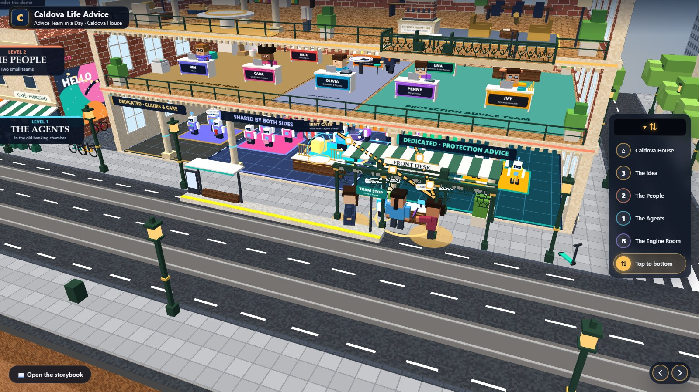

Out front, the house meets the people it serves. Clients, families and referral partners arrive by **tram** at the stop in front of Caldova House. They step off and walk to **the front desk** under the verandah ("FRONT DESK · Welcome to Caldova"), where **the greeter** welcomes them, **Amelia**, Caldova's adviser, gets them started, and they sign their fact find, referral or claim notification.

1. The tram pulls in at the stop, the greeter calls "Welcome to Caldova!", the doors slide open and the visitor steps off, with their business partner or support person where they have one.
2. Olivia's **Fact Find Extraction** agent walks out from its bay through the colonnade to the desk, and Amelia welcomes the visitor as they walk up.
3. The visitor signs. Then Amelia links them with the agents that get them started, one at a time: her tablet lights up in each agent's colour, a gold beam runs from her to the agent's bay on Level 1, and the bay lights up.
4. The paper gets a SIGNED stamp, the agent scans it, and a note reads "Signed · sent to Onboarding": it becomes a new Client Case.
5. The visitor walks back to the tram stop, waits for the next tram and rides home, and Amelia's beams fade.

| Who comes by | Side | Signs | Amelia links them with |
|---|---|---|---|
| Priya, and George with Harpreet, in the finale | Protection Advice | Their fact find (see the [finale](#finale--one-request-top-to-bottom)) | The Onboarding and Paraplanning agents |
| Tom with Kylie, his support person, and Robert, in the finale | Claims & Care | Tom's claim notification, and the notification of Mei's death | The Onboarding and Claims agents |
| For Grace's scenario, someone in a cap and dark glasses, signing in Grace's name | Claims & Care | A trauma claim and a bank change on Grace's policy, while Grace is in Italy | The Onboarding Agent. Felix's Financial Crime Agent checks the request later. |
| A young couple with their first home | Protection Advice | A fact find for their new home | The Onboarding and Paraplanning agents |
| A business owner | Protection Advice | A fact find to protect her design studio | The Onboarding and Insurance Research agents |
| A client at his annual review | Claims & Care | His annual review update | The Onboarding and Client Communications agents |
| A client making a claim | Claims & Care | A trauma claim notification | The Onboarding and Claims agents |
| A mortgage broker | Both sides | A referral, with her client's consent | The Onboarding Agent |

Amelia's words are kind and plain, especially for Tom's injury and Robert's loss: "Hi Tom, hi Kylie. We'll help you through this." and "Hi Robert. Take all the time you need." Her beams show while the front desk and the agents are in view (the cover, Chapter 3 and the finale's arrival), and give way to anything else the viewer has clicked.

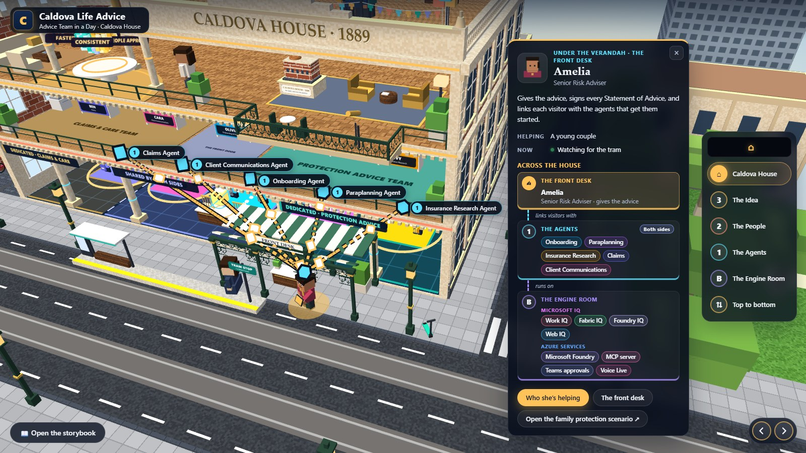

Whenever the finale isn't playing, the everyday visitors keep coming, one tram at a time.

> **In the scenarios**, requests arrive as referral emails, enquiries, calls and claim notifications. The front desk and the tram are the storybook's way of showing them coming in.

### The Roof: a Party for the Clients

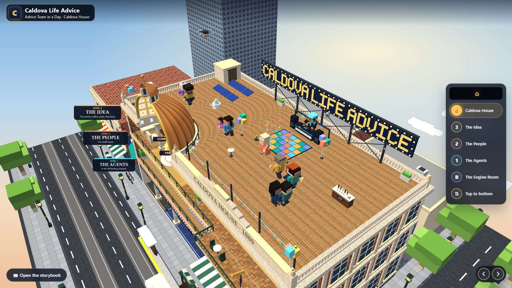

Up on the roof, Caldova Life Advice throws a party for the people the whole house works for: its clients and the referral partners who send them. It is the first thing viewers see on the cover, before the story goes down through the house.

- **The sign:** CALDOVA LIFE ADVICE in big glowing gold voxel letters on a navy board along the back of the roof, framed by chasing marquee bulbs on a steel frame. Fireworks go up behind it every so often.
- **The party deck:** timber decking around the copper dome, with string lights from the front posts up to the sign, and bunting in the party colours (the two sides' gold and teal, the shared lilac, and the levels' coral and cyan).
  - **The DJ booth**, with turntables, speakers that kick on the beat, a lighting truss and a banner: "Celebrating our clients and referral partners".
  - **The dance floor**, with tiles that change colour on the beat and a confetti cannon at each front corner.
  - **The bar**, two cocktail tables and balloons.
- **The welcome cake** ("Welcome to the Caldova family"), a lounge, the solar panels and the lift that brings the guests up.
- **The dome's gallery rail**, where guests peek down through the cut at the brain glowing in Maya's office.

| Guest | Who they are |
|---|---|
| Priya, Arjun and Asha | Priya's family cover started this week. She is here with her partner Arjun and their daughter Asha, who is two. |
| George, Helen and Harpreet | Celebrating the succession plan for Northcote Custom Joinery: George, his wife Helen, and his business partner Harpreet |
| Hannah Lewis and Marcus Tan | The referral partners, Yarra Home Loans and Bayside Business Accountants, here with their clients |
| A client back at work, and a retired couple | Clients from both sides. One is back at work after an income protection claim saw her family through her recovery. |

The guests come and go like everyone else in the house. They dance, get a drink at the bar, try the cake, take in the city and peek down at the brain, and always come back to their table or the lounge. A speech bubble says what each is doing. Every so often the DJ calls a toast ("To George and Harpreet's succession plan!", "To Priya and Arjun's new home!" or "To all our clients and referral partners!"): glasses go up, everyone says "Cheers!", and the confetti cannons fire.

The guests are the clients with happy news. The finale's other requests (a scam, an injury and a bereavement) are not party stories, so Grace, Tom and Robert are not on the roof. When the finale plays Priya's or George's request, they leave the party and go down to the front desk to sign (Harpreet goes with George).

- **Interaction:** Click the sign, the dance floor, the DJ booth, the bar, the cake or the lounge for the party's card: what it is, who is there and what is happening now. "Take a closer look" flies the camera to the roof. Click a guest for their card. Priya's and George's cards end with "Watch her request ›" or "Watch his request ›", which replays it in the finale.

---

## How to Read the Storybook

The storybook has a cover, four chapters (one per level) and a finale. Each chapter opens up its level: the levels above lift away and fade out, so the camera can look straight in.

| Control | What it does |
|---|---|
| **Begin the story ›** on the cover | Opens Chapter 1 |
| **Next › / ‹ Back**, the page dots, or the **arrow keys** | Turn the page; down and right go deeper |
| **The lift** on the right (⌂, 3, 2, 1, B, ⇅) | Jumps to any level; the display shows the floor and the direction of travel |
| **The arrows** at the bottom right (‹ ›) | Slide the view left or right, for example to see past a card. A press moves a step, and holding keeps it moving, as far as the edge of the house and the front desk. Turning the page, or pressing the current floor in the lift, brings the view back |
| **Click** a person, the brain, an agent or one of its assistants, a machine, the front desk, Amelia or a visitor | Opens its card, lights it up and draws its beams through the house |
| **Card actions** such as "Follow Cara down to the agent ↓", or any name in a card's **Across the house** | Move along the thread to the level below or above |
| **A beam's label** in the house, such as "B · Microsoft IQ" | Goes to that end of the beam |
| **Esc**, or clicking empty space | Closes the card |
| **–** on the page card | Hides the storybook so the viewer can explore freely; **📖 Open the storybook** brings it back |
| **Drag / scroll** | Orbit and zoom at any time |
| **Home / End** | Cover / finale |

Every page has a deep link, for example `/?page=people`. The address bar updates as the viewer turns pages.

---

## The Pages

### Cover — One Practice, Two Sides, Four Levels


- **Scene:** The whole of Caldova House on its city block at golden hour, with the camera slowly circling until the viewer touches it. The level tags float beside the house, the dollhouse cut shows the gold and teal wings on every floor, a tram brings a visitor to the front desk under the verandah, and the clients' party is in full swing on the roof around the copper dome, under the CALDOVA LIFE ADVICE sign.
- **Narration:** "Caldova Life Advice is a life insurance advice practice built for the agentic era. It has two sides, Protection Advice and Claims & Care, and runs both from Caldova House, a bank built in 1889 on a Melbourne city corner, with a futuristic office inside. Read it from the top down: the owner's idea under the copper dome, two small teams, one group of AI agents in the old banking chamber and, in the old vault, Microsoft IQ and the Azure services that power it all. Out front, clients arrive by tram and sign in at the front desk under the verandah, where Amelia, Caldova's adviser, gets them started. Up on the roof, Caldova throws a party for them."
- **Interaction:** "Begin the story ›" or "Explore freely". The cover lists the four levels with their colours.

### Chapter 1 — Level 3 · The Idea

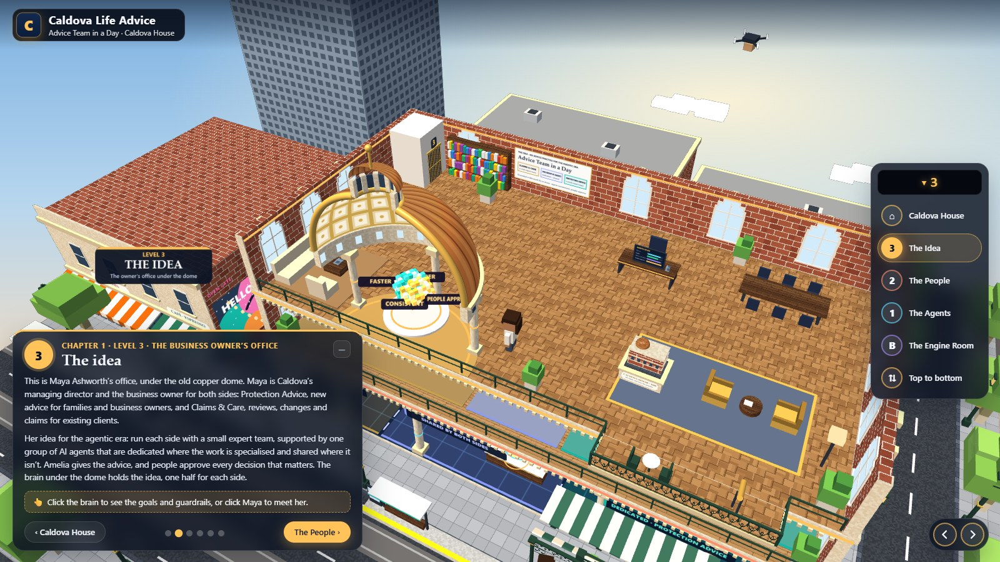

- **Scene:** The roof lifts off Maya's office.
  - Under the copper dome is a rotunda: a half-round gold rug with an inlaid ring, and three render columns with gold bands carrying the dome's drum. At its heart is a round white table, and above it floats a voxel brain with **one hemisphere for each side**: gold for Claims & Care and teal for Protection Advice, joined by a lilac bridge for what they share. Four goal tiles orbit it: CLEARER, FASTER, CONSISTENT, PEOPLE APPROVE. Maya stands just outside the rotunda, facing it.
  - On the back wall is a vision board: "The idea · An advice practice for the agentic era · Advice Team in a Day", with three panels (Claims & Care, One group of agents, Protection Advice) and "Grounded in Microsoft IQ on Azure · agents recommend, people approve". Beside it is a bookshelf by the lift, and Maya's desk has a North Star dashboard.
  - In the lounge corner by the laneway windows are a sofa and a floor lamp, and Biscuit the office dog is asleep on her bed. On the right are the boardroom, with a "Both sides, this week" screen, and a scale model of Caldova House on a plinth ("CALDOVA HOUSE · 1889 · the bank, and now the practice") with two reading chairs.
  - At the front right is a cast-iron lace balcony over the street, with a bistro table and a telescope pointed at the tram line. Maya moves about her office as she works, and stops at the telescope to watch the trams come in.
- **Narration:** "This is Maya Ashworth's office, under the old copper dome. Maya is Caldova's managing director and the business owner for both sides: Protection Advice, new advice for families and business owners, and Claims & Care, reviews, changes and claims for existing clients. Her idea for the agentic era: run each side with a small expert team, supported by one group of AI agents that are dedicated where the work is specialised and shared where it isn't. Amelia gives the advice, and people approve every decision that matters. The brain under the dome holds the idea, one half for each side."
- **Interaction:**
  - **The brain:** its card shows the idea, the two sides with what they look after and their teams, the one group of agents, the four goals, the lifecycle and the guardrails. Gold beams drop from the brain to every person on Level 2, each labelled with their name.
  - **Maya:** her card: her role, the goals she sets and what she is doing now, then **Across the house** (see [Following a Thread](#following-a-thread)): her office at the top, both teams and the shared middle, the one group of agents by side, and everything they run on in the engine room.
- **Intro beat:** the brain lights up and spins faster.

### Chapter 2 — Level 2 · The People

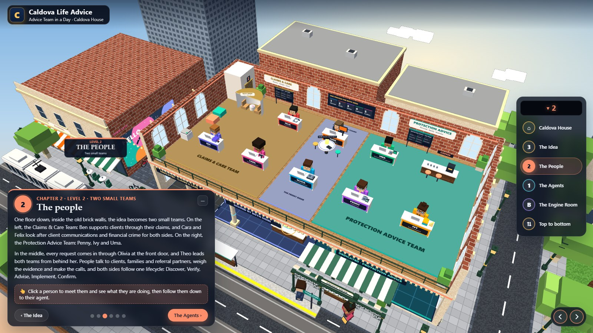

- **Scene:** Level 3 lifts away to reveal the open-plan team floor inside the old brick walls and arched windows, split into two wings with the shared middle between them.
  - **Left wing:** the Claims & Care Team on a gold rug, lettered CLAIMS & CARE TEAM, under a CLAIMS & CARE sign (Reviews · changes · claims) and its holographic team board ("Claims & Care · this week": to do, with an agent, waiting on a person).
  - **Right wing:** the Protection Advice Team on a teal rug, lettered PROTECTION ADVICE TEAM, under a PROTECTION ADVICE sign (Personal · family · business) and its own team board.
  - **In the middle,** on a lilac rug: Olivia at the front, lettered THE FRONT DOOR, and Theo behind her, lettered LEADING BOTH TEAMS, below the ONE PROCESS FOR BOTH SIDES board (Discover, Verify, Advise, Implement, Confirm). Between them is the huddle table ("both teams meet here").
  - Every standing desk has a name panel in the department colour and a prop that says something about the role: Olivia's inbox tray, Penny's calculator beside a draft Statement of Advice, Ivy's stack of PDSs and bar chart, Felix's magnifier, Uma's application on a clipboard and heartbeat screen, Ben's claim folders and stamp, Cara's headset and Theo's dashboard.
  - At the back left is the QUIET ROOM ("for sensitive calls"), a curved white pod with a gold edge. At the back right is the coffee bar, and there is a printer by the laneway wall.
  - People come and go from their desks as they work: Ben takes a quiet call with a family, Penny checks in with Ivy, Olivia collects printouts, and Theo drops by Cara's desk with a quick question. A speech bubble says what each is doing.
- **Narration:** "One floor down, inside the old brick walls, the idea becomes two small teams. On the left, the Claims & Care Team: Ben supports clients through their claims, and Cara and Felix look after client communications and financial crime for both sides. On the right, the Protection Advice Team: Penny, Ivy and Uma. In the middle, every request comes in through Olivia at the front door, and Theo leads both teams from behind her. People talk to clients, families and referral partners, weigh the evidence and make the calls, and both sides follow one lifecycle: Discover, Verify, Advise, Implement, Confirm."
- **Interaction:** Click a person to open their card. A gold ring appears at their feet. The card is kept short:
  - their role in one line, as in [characters.md](characters.md)
  - **Now:** what they are doing right now, which updates while the card is open
  - **Across the house:** the person, their agent one floor down with its side (dedicated to one side or shared by both) and its assistants, and what it runs on in the engine room (see [Following a Thread](#following-a-thread))

  "Follow {name} down to the agent ↓" opens Chapter 3 with that agent selected. "Open the agent page ↗" opens the backend's `/agents/{id}` walkthrough.
- **Intro beat:** "The idea drops in": gold sparks fall from where the brain sits above and land on each desk, and each person lights up as their spark arrives.

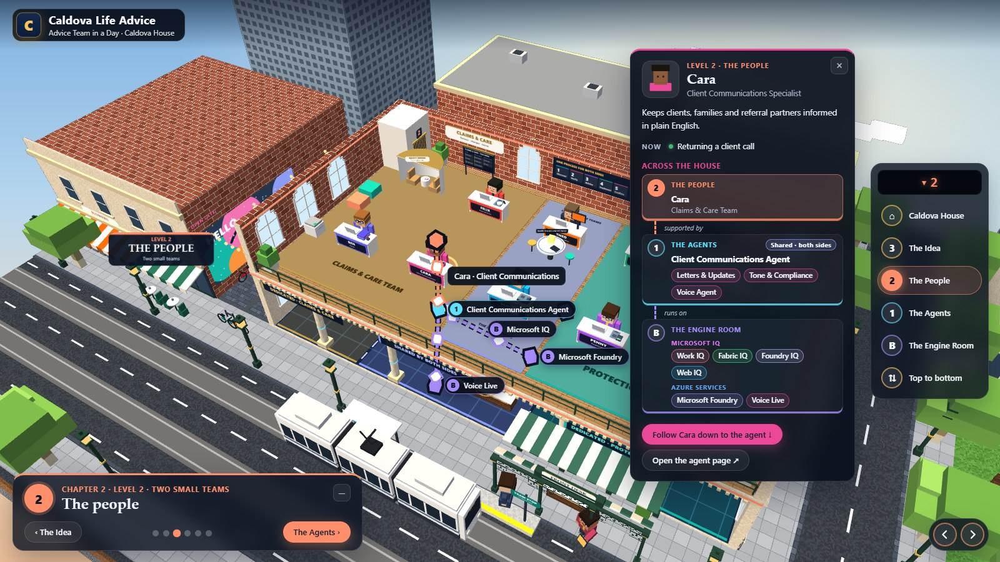

### Chapter 3 — Level 1 · The Agents

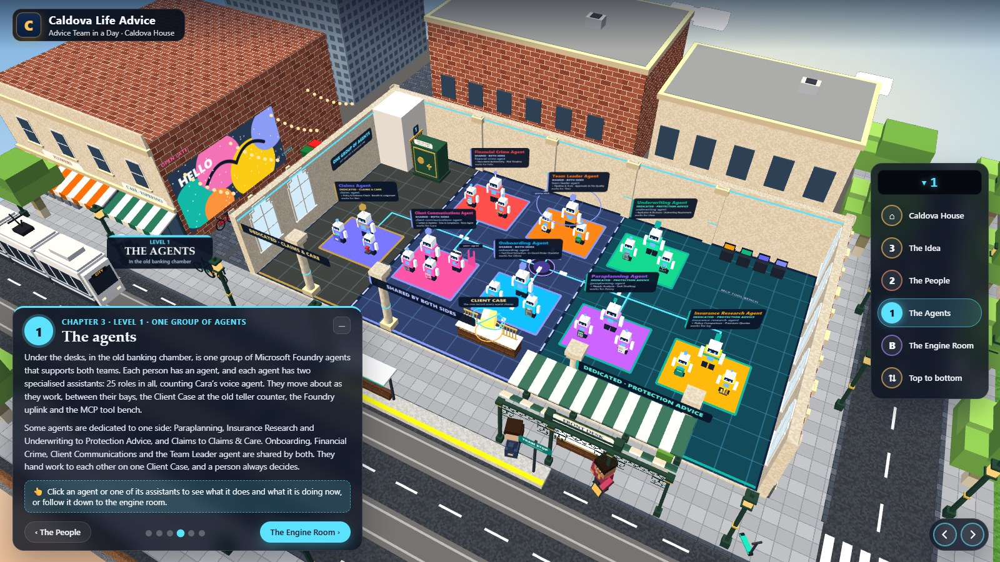

- **Scene:** Level 2 lifts away to reveal the old banking chamber at street level: tall render walls with pilasters, a row of stone columns along the front, and a dark floor with a glowing grid, split into three tinted zones by dashed lines. A sign for each zone runs along the top of the colonnade: DEDICATED · CLAIMS & CARE (gold), SHARED BY BOTH SIDES (lilac) and DEDICATED · PROTECTION ADVICE (teal).
  - Under every desk is a coloured bay for that person's agent and its two assistants, each a voxel robot. The bay's frame glows in its side's colour.
  - Each bay has a holo panel showing the agent's name, its side, its Foundry agent id, its two assistants and "works for {name}".
  - The **Client Case** glows above the old teller counter at the front of the shared zone, behind its brass grilles ("the one record every agent shares"), wired to every bay by circuit traces that carry data packets out and back.
  - Behind it is the **Foundry uplink**, a violet ring that lights up with a beam whenever a robot is calling the model. At the back right is the **MCP tool bench** with four coloured terminals, and at the back left, by the lift, the old bank safe.
  - Theo's bay has a floating **group chat** ring, and Cara's has a **voice agent** equaliser.
  - The laneway wall reads "ONE GROUP OF AGENTS · Each agent with its specialised roles".
  - The robots come and go from their bays as they work (see [The Agents](#the-agents-level-1)), each with a speech bubble saying what it is doing.
  - When Amelia links a visitor at the front desk with an agent, a gold beam runs from her to its bay and the bay lights up.
- **Narration:** "Under the desks, in the old banking chamber, is one group of Microsoft Foundry agents that supports both teams. Each person has an agent, and each agent has two specialised assistants: 25 roles in all, counting Cara's voice agent. They move about as they work, between their bays, the Client Case at the old teller counter, the Foundry uplink and the MCP tool bench. Some agents are dedicated to one side: Paraplanning, Insurance Research and Underwriting to Protection Advice, and Claims to Claims & Care. Onboarding, Financial Crime, Client Communications and the Team Leader agent are shared by both. They hand work to each other on one Client Case, and a person always decides."
- **Interaction:** Click a robot or its bay to open its card. Cards are kept short:
  - **An agent** (the big robot, or its bay): what it does in one line, who it hands off to and what it is doing now, then **Across the house**: its person above, its side and assistants, and what it runs on in the engine room. Beams drop to those components. "Back up to {name} ↑" or "What powers it ↓".
  - **An assistant or the voice agent:** what it does in one line and what it is doing now, then the same **Across the house**, with this assistant marked. The Fact Find Extraction card adds that it reads every signed form at the front desk. "Meet the {agent}" or "Up to {name} ↑".
  - **Open the agent page ↗**, under the name on all of these cards, opens the agent's own page in the backend agent console in a new tab. An assistant's or the voice agent's card opens the page of the agent it works for.

  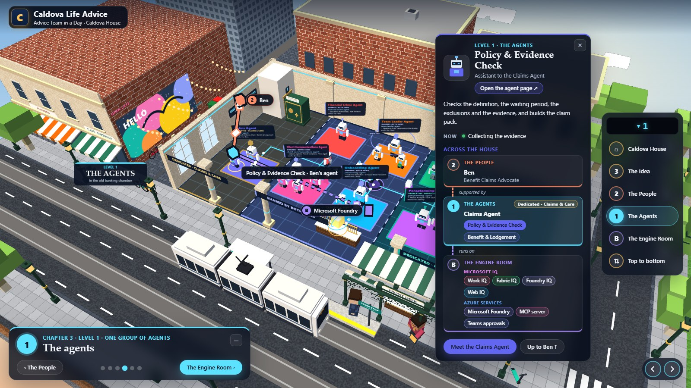
- **Intro beat:** the bays power up one after another.

### Chapter 4 — B · The Engine Room

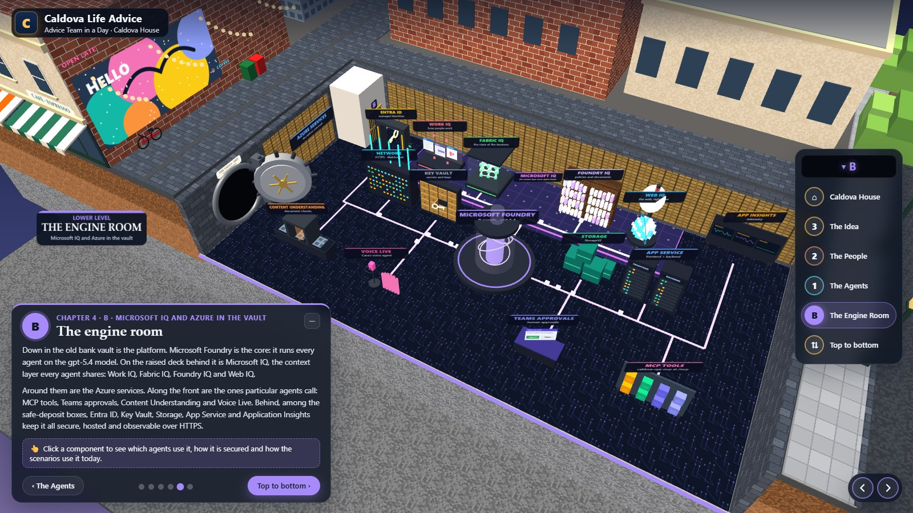

- **Scene:** Level 1 lifts away and the street in front is cut away, revealing the old bank vault under the house. The sky turns to dusk.
  - **Microsoft Foundry** sits in the middle as a glowing core with orbiting rings, and a beam rises from it to the agents above.
  - **The Microsoft IQ deck** is behind the core: a raised violet platform with a glowing fuchsia edge and a MICROSOFT IQ sign ("the context layer every agent shares"). It holds:
    - **Work IQ:** floating document, chat and meeting tiles with signals orbiting them.
    - **Fabric IQ:** a rotating lattice of business entities and their relationships in a glass case.
    - **Foundry IQ:** shelves of indexed documents with a scanning beam.
    - **Web IQ:** a voxel globe with an antenna.
  - **Along the front:** the Content Understanding scanner, the Voice Live studio mic, the Teams approvals console with its floating approval card ("Claim approval · A person approves before lodging"), and the MCP tool rack.
  - **Behind the bus:** the Entra ID gate (beside the lift), the network patch panel with blinking ports, the Key Vault deposit-box cabinet with its floating key, the storage crates, the App Service racks (FRONTEND, BACKEND) and the App Insights screens, in front of the brass safe-deposit boxes.
  - The round vault door stands open by the laneway wall under its plaque ("THE VAULT · 1889 · now the engine room"), and an AZURE SERVICES sign ("the platform underneath") hangs beside it.
- **Narration:** "Down in the old bank vault is the platform. Microsoft Foundry is the core: it runs every agent on the gpt-5.4 model. On the raised deck behind it is Microsoft IQ, the context layer every agent shares: Work IQ, Fabric IQ, Foundry IQ and Web IQ. Around them are the Azure services. Along the front are the ones particular agents call: MCP tools, Teams approvals, Content Understanding and Voice Live. Behind, among the safe-deposit boxes, Entra ID, Key Vault, Storage, App Service and Application Insights keep it all secure, hosted and observable over HTTPS."
- **Interaction:** Click a component to open its card. It shows:
  - its tier (Microsoft IQ or Azure services) and what it is
  - for the IQ components, how the scenarios use it today
  - the technical details, and how it is secured and connected
  - **Across the house:** the people and agents that run on it, up through the house

  "Back up to the agents ↑" opens Chapter 3 with those agents ringed.
- **Intro beat:** the traces light up outward from Foundry.

### Finale — One Request, Top to Bottom

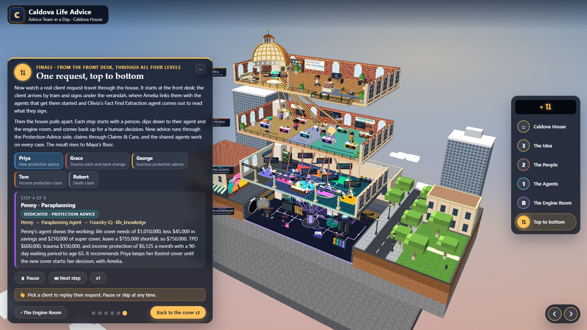

- **Scene:** The finale opens at the front desk with the house together. The client's tram pulls in, they step off and sign under the verandah, Amelia links them with the agents that get them started, and Olivia's Fact Find Extraction agent comes out to read what they sign (see [The Front Desk](#the-front-desk-and-the-tram)). Once it is signed, the request glows above the desk, and the house pulls apart into an exploded view as the request sets off: all four levels stacked with gaps between them. Threads show the whole house as one tree: gold from the brain to every person, coral from each person to their agent, violet from each agent to Microsoft Foundry.
- **Narration:** "Now watch a real client request travel through the house. It starts at the front desk: the client arrives by tram and signs under the verandah, where Amelia links them with the agents that get them started and Olivia's Fact Find Extraction agent comes out to read what they sign. Then the house pulls apart. Each step starts with a person, dips down to their agent and the engine room, and comes back up for a human decision. New advice runs through the Protection Advice side, claims through Claims & Care, and the shared agents work on every case. The result rises to Maya's floor."
- **The trace:** a glowing orb carries one client's request through the house. The steps come from the scenario beats in `src/frontend/src/scenarios/*.json`, which mirror the five scenario documents. Two are Protection Advice requests and three are Claims & Care requests.
  1. **Arrival:** the client arrives by tram, Amelia welcomes them, and they sign at the front desk: Priya her fact find, George and Harpreet their business protection fact find, Tom (with Kylie, his support person) his claim notification, and Robert the notification of his wife Mei's death. In Grace's story, someone in a cap and dark glasses signs a trauma claim and a bank change in her name while she is in Italy. When the form is signed, the orb appears above the desk.
  2. **Each step:** the orb stops at the person (Level 2), drops to their agent (Level 1), and dips to the engine-room component that agent leans on. It then comes back up to the person, who decides. A handover, such as Ben confirming that no claim was lodged, is just a short stop.
  3. **Result:** the orb rises to the brain on Level 3 with the outcome.

  | Client | Request | Case | Who works the case | Outcome |
  |---|---|---|---|---|
  | Priya Natarajan | New protection advice | `REQ-20261103-LIF001` | Olivia → Felix → Penny → Ivy → Penny → Uma → Cara | Completed — covered from 18 Nov 2026 |
  | Grace Williams | Trauma claim and bank change | `REQ-20261106-LIF002` | Olivia → Ben → Felix → Theo → Ben → Cara | Blocked — no claim lodged, $200,000 protected |
  | George Papadopoulos | Business protection advice | `REQ-20261109-LIF003` | Olivia → Felix → Penny → Ivy → Theo → Uma → Cara | Completed — business protected from 20 Nov 2026 |
  | Tom Bradley | Income protection claim | `REQ-20261111-LIF004` | Olivia → Ben → Felix → Theo → Ben → Cara | Partially approved — $5,600 a month, not the $7,000 insured |
  | Robert Chen | Death claim | `REQ-20261113-LIF005` | Olivia → Theo → Felix → Ben → Cara | Completed — $1,000,000 paid to Robert |
- **Panel:**
  - the client chips: Priya, Grace, George, Tom and Robert (Priya by default)
  - the current step, with a chip for its side, for example "Step 1 of 9 · Priya Natarajan · arrives by tram · PROTECTION ADVICE REQUEST · Priya Natarajan → Front desk → Fact Find Extraction agent", then "Step 4 of 9 · Penny · Paraplanning · DEDICATED · PROTECTION ADVICE · Penny → Paraplanning Agent → Foundry IQ · life_knowledge"
  - the narration, and **Pause**, **Next step** and **x1/x2/x4** controls. They work during the arrival too: Pause holds the tram, and Next step skips ahead to the signature.

  The chip reads "Protection Advice request" or "Claims & Care request" on arrival, then "Dedicated · Protection Advice", "Dedicated · Claims & Care" or "Shared · both sides" for each step, with "· called in" if a request ever uses the other side's dedicated agent.
- **Interaction:** Pick a client to replay their request: the house comes back together at the front desk for their arrival. "Back to the cover ↺" starts the storybook again.

---

## Following a Thread

Every card ends with actions that move along the same thread, so viewers can trace any part of the house to the rest of it.

**Across the house.** Cards for Maya, people, agents, assistants and components show a small cross-section of the house below the text, read from the top down like the house itself. Each level is drawn like its floor slab, with its badge (3, 2, 1, B) and its accent edge, and dashed rungs between the levels say how they connect: "sets the goals for", "supported by" and "runs on".

- **People (2):** the person, and their team or their place in the middle (the front door, or leading both teams).
- **Agents (1):** their agent, with its side (dedicated or shared) and its assistants.
- **Engine room (B):** what it runs on, in two tiers: the Microsoft IQ components, then the Azure services.

The card's own level is lit, and on an assistant's card that assistant is lit too. Every other name is a link that opens its card, on its own level.

Amelia's card starts at the front desk instead: the front desk (✍) with Amelia lit, "links visitors with" the five agents she works with (across both sides), and what they run on in the engine room. Hovering an agent's name says what it does to get a visitor started.

**Beams in the house.** A selection draws beams in the house's thread colours: gold from the idea, coral from a person to their agent, and violet from an agent down to the engine room.

- **Solid or dashed:** a beam is a solid line with a dark outline where it can be seen, so it reads on light floors and dark ones alike. It turns dashed where it runs behind or through a floor, so the viewer can always see where it goes. The dashed part never covers a sign.
- **Moving:** the dashes and small voxel packets run the way the work flows.
- **Nodes and labels:** a voxel node in the level's colour marks each end. The far ends carry a small label with the level badge and a name, such as "1 · Claims Agent" or "B · Microsoft IQ", and clicking a label goes there.
- **Lifted levels:** an end on a level that has lifted away stays where that level would be. Its beam then shows only where it can be seen.
- **Microsoft IQ:** an agent's beams go to Microsoft IQ as a whole (one beam to the IQ deck) and to each Azure service it calls.
- **Staying in view:** beams keep the same thickness on screen at any zoom. If the card would cover what was clicked, the camera slides it into view beside the card.

| Click | Lights up | Beams drawn | Card actions |
|---|---|---|---|
| Maya | Maya and the brain | Brain → every person | See her idea · Meet the team ↓ |
| The brain | The brain | Brain → every person | Meet the team ↓ · Meet Maya |
| A person | The person, their bay, and their engine-room dependencies | Person → agent → Microsoft IQ and each Azure service | Follow them down ↓ · Open the agent page ↗ |
| An agent (or its bay) | The bay, its person, and its dependencies | Person → agent → Microsoft IQ and each Azure service | Open the agent page ↗ (under its name) · Back up ↑ · What powers it ↓ |
| An assistant or the voice agent | The robot, its person, and Microsoft Foundry | Person → assistant → Microsoft Foundry | Open the agent page ↗ (under its name) · Meet the agent · Up to the person ↑ |
| A component | The component and every agent that uses it | Component → each agent that uses it (→ its person, when only a few do) | Back up to the agents ↑ |
| The front desk, or the greeter | The desk, the greeter, Amelia, the Fact Find Extraction agent and Olivia | Desk → Fact Find Extraction agent → Olivia | Who is signing · Meet Amelia · Meet the Fact Find Extraction agent · Up to Olivia ↑ |
| A visitor (or their companion) | The same as the front desk | The same as the front desk | The front desk · Meet Amelia |
| Amelia | Amelia and the bays of the five agents she links visitors with | Amelia → the Onboarding, Paraplanning, Insurance Research, Claims and Client Communications agents | Who she's helping · The front desk · Open the family protection scenario ↗ |
| The party (its sign, dance floor, DJ booth, bar, cake or lounge) | Every guest and the DJ | — | Take a closer look · Meet George |
| A party guest | The guest | — | Watch her or his request › (Priya and George) · The celebration |

Only the level being read is clickable, so a click never lands on something hidden under a floor. The front desk is out front, so it stays clickable whenever the street is showing, and the party is clickable whenever the roof is in place.

---

## Visual Direction

- Voxel and isometric: a miniature diorama of a city block with a high three-quarter camera.
- **Heritage outside, futuristic inside:** the 1889 bank is crafted in voxels (red brick, cream render, bluestone, arched windows with keystones, cornices with dentils, quoins, pilasters, a balustraded parapet, cast-iron lace and the copper dome), wrapped around a clean, bright, modern office (white desks, neon edge strips, holographic boards, a glowing grid floor, the tram and the drone). Old meets new where it shows: the brass cage lift doors, the teller counter turned into the Client Case, and the vault turned into the engine room. It should never feel like a data centre brochure.
- **The dollhouse cut:** the front of the house is open, with no glass facade, so every level reads from the orbit camera. Trees and lamp posts stand beside the house, never in front of a floor.
- **Sharp, not hazy:** no bloom, glow layer, blur or glass in the way. Lit parts (signs, screens and edge strips) are flat bright colours on solid backings, and the scene draws at the screen's full resolution, so every label reads cleanly. On a window narrower than 16:9, the view widens instead of cropping the sides.
- **Alive, not busy:** people and robots move about their floors at an easy pace and always come back to their desks and bays. A speech bubble says what each is doing.
- **One accent per level:** Idea `#ffc35a` (gold) · People `#ff8f6b` (coral) · Agents `#5ce1ff` (cyan) · Engine Room `#a78bfa` (violet).
- **One colour per side**, used for rugs, signs, zones, bay frames, sashes and badges: Claims & Care `#c9a14a` (gold, on the left) · Protection Advice `#14b8a6` (teal, on the right) · Shared by both `#8b9cf7` (lilac, in the middle). Each department keeps its own colour for its desk and bay. Large floor areas such as the Level 2 rugs use a muted mid-tone of the side's colour: pale colours wash out to white in the sunlight, and then the white desks and the people on them are hard to see.
- **Two tiers underground:** Microsoft IQ `#e879f9` (fuchsia) on the raised deck, and Azure services `#60a5fa` (blue) around it.
- **Readable at a glance:** every desk, bay and machine carries a sign, every assistant carries a prop for its job, and each card says what the thing is in plain English before any technical detail. Cards for Maya, Amelia, people, agents, assistants and visitors stay short: one line, then a few labelled facts, including what they are doing now. Any further detail goes into the card's Across the house cross-section, as names to click rather than more text.
- **A generic, fictional city:** the tram has no route number or livery (its display reads "CITY"), and the café, florist, towers and street are made up. No real insurer, fund, adviser or business names, logos or addresses.
- **Words on screen:** never call anything a "demo". Say "scenario" or "use case" instead, for example the "In the scenarios" note on a card and "Open the family protection scenario ↗".
- **Avoid:** real company logos, readable personal, health or financial details beyond the scenario figures, anything suggesting agents decide or give advice on their own, and claiming the scenarios use an IQ component they don't. The front desk, the tram and the rooftop party are storybook devices: say so wherever they could be mistaken for part of the scenarios.

---

## Keeping the Storybook in Sync

| What | Where |
|---|---|
| Page text, camera shots (including the finale's front desk shot) and stack modes | `src/frontend/src/v2/storyData.ts` (mirrors this document) |
| The two sides, Maya, the idea, each agent's side, the roles and their props and tasks, the handoff rules, the IQ tier and Azure services | `src/frontend/src/v2/houseData.ts` |
| The front desk, Amelia, the finale clients' arrivals (with Amelia's welcome, links and companions), the everyday visitors | `src/frontend/src/v2/houseData.ts` (data) and `frontDesk.ts` (the verandah, desk, greeter, Amelia, the tram and each visit) |
| The city block: the street, tram stop, laneway, café, park, trees, lamps and drone | `src/frontend/src/v2/street.ts` |
| The heritage pieces: brick, render, bluestone, arched windows, cornices, balustrades and cast-iron lace | `src/frontend/src/v2/heritage.ts` (pieces) and `shell.ts` (each floor's slab, walls, facades, rails, lift and level tag) |
| The party on the roof: its guests and the sign's text | `src/frontend/src/v2/houseData.ts` (data) and `party.ts` (the deck, sign, DJ, dance floor, toasts and fireworks) |
| Walking: where people, Maya and the robots go on errands, and their speech bubbles | `src/frontend/src/v2/wander.ts` (walking) and `levels/*.ts` (each floor's errands) |
| Desk positions, wings (Level 2), zones (Level 1), the dome, the street and the front desk | `src/frontend/src/v2/layout.ts` |
| Staff, teams, assistants and clients | `src/frontend/src/personaData.ts`, `agentStages.ts` and `characterPalettes.ts` |
| The finale's steps | `src/frontend/src/scenarios/*.json` (mirror the scenario documents) |
| The levels, the dome and the roof | `src/frontend/src/v2/levels/*.ts` |
| Cards, including their Across the house cross-section | `src/frontend/src/v2/inspector.ts` |
| What a click lights up, and the beams it draws and labels, and Amelia's live beams | `src/frontend/src/v2/main.ts` (which beams), `threads.ts` (drawing them) and `callouts.ts` (their labels) |

**To run it locally**, start the frontend with `npm run dev` in `src/frontend`, then open <http://localhost:5173/>.

**In production**, App Service serves the build with `pm2 serve --spa`, which answers every path with `index.html`. Old `/v2` links still open the storybook, and the page tidies the address to `/`, keeping any `?page=` deep link.
